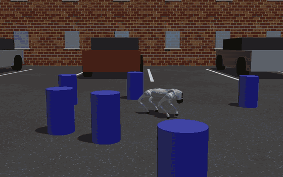

<h1 align="center">FOSA</h1>

<p align="center">
  <strong>Generative Flow on Symbolic Abstractions for Embodiment Capability Discovery</strong>
</p>

<p align="center">
  <a href="https://openreview.net/forum?id=weyfPS89NJ"></a>
  <a href="https://www.youwei-yu.com/fosa/"></a>
  <a href="https://arxiv.org/abs/2610.17174v1"></a>
  <a href="https://huggingface.co/datasets/SICE-FISH/FOSA"></a>
</p>

<p align="center">
  
</p>

FOSA discovers which tasks a robot can learn. A GFlowNet over symbolic task skeletons proposes a task, an LLM compiles
it into a MuJoCo Playground environment, and PPO trains a task policy on it: the policy's learning curve is the
GFlowNet's reward. The task policies are then distilled into one language-conditioned student.

## 🤖 Installation

```bash
conda create -n fosa python=3.11 -y
conda activate fosa
conda install conda-forge::uv -y
uv pip install -e . --no-cache
```

The robot models are downloaded from the [dataset](https://huggingface.co/datasets/SICE-FISH/FOSA) on first use.

<details>
<summary>LLM</summary>

FOSA talks to any OpenAI-compatible chat endpoint. The paper uses Gemma 4 31B, which you can serve locally, e.g. with
[vLLM](https://github.com/vllm-project/vllm):

```bash
vllm serve google/gemma-4-31B-it --served-model-name gemma-4-31B-it --port 8000
```

or use a hosted model: [awesome-free-llm-apis](https://github.com/mnfst/awesome-free-llm-apis) lists free ones.

```bash
export FOSA_LLM_ENDPOINT=http://localhost:8000/v1/chat/completions  # default
export FOSA_LLM_MODEL=gemma-4-31B-it                                  # default
export FOSA_LLM_API_KEY=...                                           # if the server needs one
```

</details>

<details>
<summary>Task grammars of the paper</summary>

Each robot's task grammar is written once by the LLM. To reuse the paper's, copy them into the log directory:

```bash
mkdir -p logs/gemma-4-31B-it && cp -r data/grammars/* logs/gemma-4-31B-it/
```

</details>

## 🔥 Discover tasks

> [!IMPORTANT]
> The paper runs each robot and method on 4 GPUs (NVIDIA A100, 40 GB).

Robots: `go2` (quadruped), `jackal` (vehicle), `booster` (humanoid), `inspire_hand` (hand).

### One method at a time

FOSA
```bash
python -m fosa.discovery.fosa --robot go2 --gpu-ids 0,1,2,3
```

Ablations
```bash
python -m fosa.discovery.fosa --robot go2 --gpu-ids 0,1,2,3 --method fosa_rnd  # FOSA-RND
python -m fosa.discovery.fosa --robot go2 --gpu-ids 0,1,2,3 --method fosa_llm  # FOSA-LLM
```

Baselines
```bash
python -m fosa.discovery.mcts --robot go2 --gpu-ids 0,1,2,3 --method mcts  # also llm_mcts, muzero (MCTS-Learn)
python -m fosa.discovery.curriculum --robot go2 --gpu-ids 0,1,2,3          # LLM-CL
```

Each run trains 256 tasks; run the same command again to resume an interrupted run.

### Everything at once on Slurm

To run every robot and method of the paper automatically, one job each:
```bash
scripts/slurm.sh go2,jackal,booster,inspire_hand all 256
```

## 🎓 Distill a student

```bash
python -m fosa.learning.dagger --robot go2 --method fosa --gpu-ids 0,1,2,3
```
On Slurm (the paper uses seeds 1, 2 and 3):
```bash
FOSA_STUDENT_SEED=1 scripts/slurm_student.sh go2,jackal,booster,inspire_hand all
```

## 📊 Evaluate

### Held-out tasks

FOSA's students from the paper are in `checkpoints/<robot>/student.pt`.
```bash
python -m fosa.evaluation.heldout prepare go2   # compile the held-out tasks
python -m fosa.evaluation.heldout train go2     # train a reference policy per task
python -m fosa.evaluation.heldout evaluate go2 --checkpoint checkpoints/go2/student.pt
```

## Citation

```bibtex
@inproceedings{yu2026generative,
  title={Generative Flow on Symbolic Abstractions for Embodiment Capability Discovery},
  author={Youwei Yu and Lantao Liu},
  booktitle={10th Annual Conference on Robot Learning},
  year={2026},
  url={https://openreview.net/forum?id=weyfPS89NJ}
}
```
